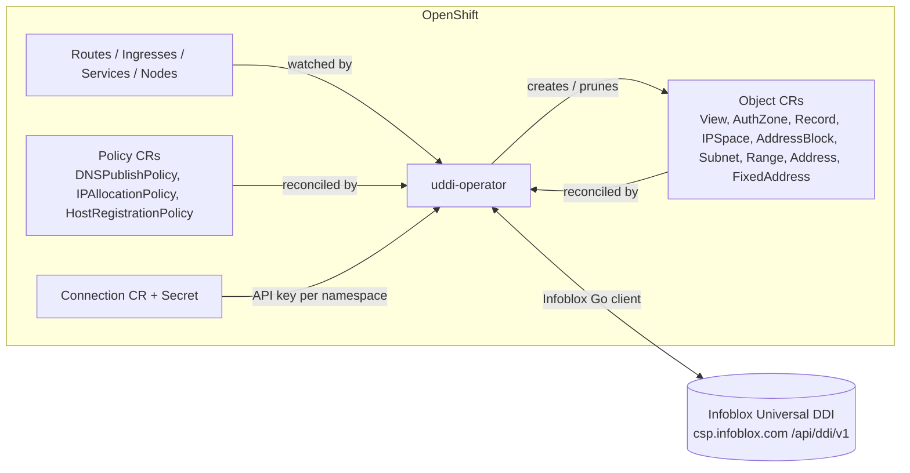

# uddi-operator design

Status: v0.1, updated 2026-10-04. Captures the decisions from the kickoff interview and the
architecture as built through milestone 4; [ROADMAP.md](ROADMAP.md) plans what follows.
Anything marked **verify** is pending confirmation against a real Universal DDI tenant.

## 1. Purpose

`uddi-operator` is an OpenShift operator that acts as a shim between OpenShift and
[Infoblox Universal DDI](https://www.infoblox.com/products/universal-ddi/) (UDDI, the
cloud-delivered DNS / DHCP / IPAM platform behind the Infoblox Cloud Services Portal).

It has two layers:

1. **Object layer.** Universal DDI objects are modelled one-to-one as namespaced custom
   resources under the `uddi.infoblox.com` API group. Reconciling a CR creates, updates,
   adopts or deletes the matching object in Universal DDI. This layer is the foundation and
   ships first.
2. **Integration layer.** Policy CRs that watch native OpenShift objects (Routes, Ingresses,
   LoadBalancer Services, Nodes) and express the desired Universal DDI state *as object-layer
   CRs*. DNS publishing, IP allocation and host / DHCP registration are all built this way,
   so they inherit ownership tracking, drift correction and cleanup from the object layer.

## 2. Decisions from the kickoff interview

| Topic | Decision |
| --- | --- |
| Scope (all in scope) | DNS record sync, IPAM allocation, UDDI objects as CRDs, host / DHCP registration |
| Phasing | Object CRDs first; DNS sync, IPAM and DHCP integrations built on top |
| Backend | Universal DDI SaaS only (CSP REST API, API-key auth) via the official `universal-ddi-go-client` (the older `bloxone-go-client` is deprecated). NIOS WAPI is out of scope. |
| Pattern | Standalone operator with its own CRDs. Not an external-dns webhook, not a DNSRecord hook. |
| Stack | Go, Operator SDK / kubebuilder v4 layout, controller-runtime |
| Credentials | Per-namespace: a `Connection` CR plus Secret in each namespace. Multiple tenants or sandboxes per cluster are supported. |
| Deletion | Delete in Universal DDI when the CR goes away, guarded by finalizers and ownership tags. Only objects carrying our tags are ever modified or deleted. |
| First CRD milestone | DNS: View, AuthZone, Record. IPAM: IPSpace, AddressBlock, Subnet, Range, Address. DHCP: FixedAddress plus DHCP options on Subnet and Range. |
| Packaging | OLM bundle and file-based catalog, installable from OperatorHub |
| Platform | OpenShift 4.16 and newer only (Kubernetes 1.29 floor) |
| CI | GitHub Actions; images, bundle and catalog pushed to quay.io |
| Naming | API group `uddi.infoblox.com`, project `uddi-operator`, Go module `github.com/IngmarVG-IB/openshiftoperator` |
| License | Apache 2.0 |
| Test assets | A Universal DDI tenant with an API key and an OpenShift cluster are available |

## 3. Architecture



Package layout (kubebuilder go/v4):

```
cmd/main.go                      manager wiring, flags, leader election, metrics
api/v1alpha1/                    CRD Go types, one file per kind, shared types in common_types.go
internal/controller/             one reconciler per kind
internal/sync/                   generic object-layer reconcile helpers (adopt, tag, diff, finalize)
internal/uddi/                   client abstraction: interfaces, real adapter over the SDK, in-memory fake
internal/connection/             Connection resolution and client cache
internal/tags/                   ownership tag helpers
internal/clusterid/              cluster identity discovery
config/                          kustomize: crd, rbac, manager, samples, manifests (OLM), default
bundle/                          OLM bundle (generated by `make bundle`)
catalog/                         file-based catalog template
test/e2e/                        cluster e2e (kind or OpenShift)
test/integration/                real Universal DDI tests, gated by UDDI_API_KEY
docs/                            API notes, user docs
hack/                            scripts
```

## 4. API: group `uddi.infoblox.com`, version `v1alpha1`

All kinds are **namespaced**. Every object-layer kind embeds the same shared fields.

### 4.1 Shared types

```go
// ConnectionRef names a Connection in the same namespace. Empty means "default".
type ConnectionRef struct{ Name string }

// ObjectRef points at another object-layer CR in the same namespace, or directly at a
// Universal DDI object by its API id (e.g. "dns/view/2c1a..."). Exactly one is set (CEL).
type ObjectRef struct{ Name string; ID string }

// Lifecycle controls adoption and deletion.
type Lifecycle struct {
    AdoptExisting  bool           // default false: an untagged existing object is a conflict
    DeletionPolicy DeletionPolicy // Delete (default) | Orphan
}

// Common status carried by every object-layer kind.
type ObjectStatus struct {
    ID                 string             // Universal DDI id, e.g. "ipam/subnet/<uuid>"
    ObservedGeneration int64
    LastSyncTime       *metav1.Time
    Conditions         []metav1.Condition // Ready, Synced
}
```

Conditions: `Ready` is the summary. `Synced=True` means the Universal DDI object matched
`spec` at `observedGeneration`. `Ready=False` reasons: `ConnectionNotReady`,
`DependencyNotReady`, `AlreadyExists` (untagged object found and `adoptExisting=false`),
`Creating`, `APIError`, `Deleting`.

Tags: every kind has `spec.tags map[string]string`. The operator merges, in order:
ownership tags (always, non-overridable), `Connection.spec.defaultTags`, then `spec.tags`.

Immutability and cross-field rules are CEL `x-kubernetes-validations` on the CRDs
(`+kubebuilder:validation:XValidation`), GA since Kubernetes 1.29, so no admission webhook
is needed on the 4.16 floor.

### 4.2 Connection

```yaml
apiVersion: uddi.infoblox.com/v1alpha1
kind: Connection
metadata: { name: default, namespace: team-a }
spec:
  cspURL: https://csp.infoblox.com          # default
  secretRef: { name: uddi-api-key, key: apiKey }   # key defaults to "apiKey"
  clientName: uddi-operator                 # sent to the API as the client name
  defaultTags: { env: prod }                # merged into every object created via this connection
  resyncInterval: 10m                       # drift detection period for objects using this connection
  rateLimit: { requestsPerSecond: 10, burst: 20 }   # client-side limiter
status:
  conditions: [ { type: Ready, ... } ]
  lastVerifiedTime: ...
```

Behaviour: the controller reads the Secret, builds an SDK client (`option.WithAPIKey`,
`WithCSPUrl`, `WithClientName`, `WithDefaultTags`, and `WithHTTPClient` carrying the
operator's rate-limiting transport), and verifies it with a cheap read call
(`ViewAPI.List` with `_limit=1`; **verify** that every API key role may list views). Clients are cached per Connection keyed by Secret
resourceVersion, so key rotation is picked up on the next reconcile. Object CRs whose `connectionRef` is empty use the Connection named
`default` in their namespace. The Secret is never logged; API errors are redacted before
they reach conditions or events.

### 4.3 DNS kinds

**View**

```yaml
spec:
  connectionRef: { name: default }
  name: default                  # defaults to metadata.name
  ipSpaces: [ { name: corp } ]   # IPSpace refs bound to the view, for reverse lookups
  comment: ""
  tags: {}
  lifecycle: {}
status: { id: dns/view/<uuid>, ... }
```

Natural key for adoption: `name`. Deleting a view in Universal DDI moves it to the recycle
bin; the natural-key lookup must ignore recycled objects (**verify** how they appear in
List results).

**AuthZone**

```yaml
spec:
  fqdn: apps.example.com.        # immutable
  viewRef: { name: default }     # or { id: dns/view/<uuid> }; immutable
  primaryType: cloud             # cloud | external; immutable
  nsgs: [ dns/auth_nsg/<uuid> ]  # at most one nameserver group; the API now rejects several
  internalSecondaries: [ { host: dns/host/<uuid> } ]     # DNS service hosts (cloud type); not combinable with nsgs
  externalPrimaries: [ { type: primary, address: 10.0.0.53, fqdn: ns1.corp. } ]  # external type
  externalSecondaries: []
  comment: ""
  disabled: false
  tags: {}
  lifecycle: { adoptExisting: true, deletionPolicy: Orphan }   # typical for pre-existing zones
status: { id: dns/auth_zone/<uuid>, warnings: [...], ... }
```

Natural key for adoption: `fqdn` + view. Zones usually pre-exist in Universal DDI, so the
sample uses adopt + orphan. The API is mid-migration from nameserver groups to a "unified
nameservers" model (`nameservers` list plus a read-only `version` of `v1` or `v2`), but
that model only exists on the SDK's untagged master branch (merged 2026-09-10, after the
v0.4.0 tag). v1alpha1 therefore models the legacy fields only, with CEL rules for the
combinations the API now rejects (more than one NSG; NSG together with internal
secondaries). `nameservers` is added when a tagged SDK ships it. The API's read-only
`warnings` are mirrored into status.

**Record**

```yaml
spec:
  zoneRef: { name: apps-zone }   # or { id: dns/auth_zone/<uuid> }; immutable
  name: www                      # name in zone; "@" or "" means the apex; immutable
  type: A                        # A | AAAA | CNAME | TXT | PTR | SRV | MX | NS | CAA; immutable
  rdata:                         # exactly one block, matching type (CEL)
    a:     { address: 192.0.2.10 }
    aaaa:  { address: 2001:db8::10 }
    cname: { cname: router-default.apps.example.com. }
    txt:   { text: "v=spf1 -all" }
    ptr:   { dname: www.example.com. }
    srv:   { priority: 10, weight: 5, port: 443, target: www.example.com. }
    mx:    { preference: 10, exchange: mail.example.com. }
    ns:    { dname: ns1.example.com. }
    caa:   { flags: 0, tag: issue, value: letsencrypt.org }
  ttl: 300
  createPtr: false               # A / AAAA only: ask the API to create the matching PTR
  comment: ""
  disabled: false
  tags: {}
  lifecycle: {}
status: { id: dns/record/<uuid>, absoluteName: www.apps.example.com., source: [STATIC], ... }
```

Natural key for adoption: zone + name + type + rdata (Universal DDI stores one rdata per
record object, so two A records for the same name are two CRs). Only records whose
`source` is `STATIC` are ever adopted, updated or deleted; `SYSTEM`, `DYNAMIC`,
`DELEGATED` and `DTC` records are reported as conflicts.

### 4.4 IPAM kinds

**IPSpace**

```yaml
spec: { name: corp, comment: "", tags: {}, lifecycle: {} }
status: { id: ipam/ip_space/<uuid>, ... }
```

**AddressBlock**

```yaml
spec:
  spaceRef: { name: corp }
  address: 10.0.0.0              # immutable; omit to allocate the next available block
  cidr: 16                       # immutable
  parentRef: { name: corp-root } # required when address is omitted (next-available block)
  name: ""
  comment: ""
  dhcpOptions: []                # see 4.6
  tags: {}
  lifecycle: {}
status: { id: ipam/address_block/<uuid>, address: 10.0.0.0, cidr: 16, utilization: {...}, ... }
```

**Subnet**

```yaml
spec:
  spaceRef: { name: corp }
  address: 10.0.10.0             # immutable; omit to allocate next available from parentRef
  cidr: 24                       # immutable
  parentRef: { name: block-10 }  # AddressBlock; required when address is omitted
  name: openshift-lb
  comment: ""
  dhcpHost: dhcp/host/<uuid>     # DHCP service host, optional
  dhcpOptions: []
  tags: {}
  lifecycle: {}
status: { id: ipam/subnet/<uuid>, address: ..., cidr: ..., utilization: {...}, ... }
```

**Range**

```yaml
spec:
  spaceRef: { name: corp }
  start: 10.0.10.100             # immutable
  end: 10.0.10.199               # immutable
  name: lb-pool
  comment: ""
  dhcpHost: dhcp/host/<uuid>
  dhcpOptions: []
  exclusionRanges: [ { start: 10.0.10.150, end: 10.0.10.159, comment: reserved } ]
  tags: {}
  lifecycle: {}
status: { id: ipam/range/<uuid>, utilization: {...}, ... }
```

The parent subnet is derived by Universal DDI from the start / end addresses.

**Address**

```yaml
spec:
  spaceRef: { name: corp }
  address: 10.0.10.7             # immutable; omit to allocate the next available address
  nextAvailableFrom: { subnetRef: { name: openshift-lb } }   # or rangeRef / addressBlockRef; immutable
  names: [ { name: svc-web.team-a, type: user } ]
  hwaddr: ""
  interface: ""
  comment: ""
  tags: {}
  lifecycle: {}
status: { id: ipam/address/<uuid>, address: 10.0.10.101, state: used, ... }
```

`status.address` is the allocated address and is the value consumers read. Allocation is
one atomic `AddressAPI.Create` call with `address` set to `<parent id>/nextavailableip`
(for example `ipam/subnet/<uuid>/nextavailableip`), the same mechanism the Infoblox
Terraform provider uses, so names, comment and the ownership tags land in the same
request. The Terraform provider serialises these creates per parent with a mutex; the
IPAM adapter does the same. The dedicated `CreateNextAvailableIP` endpoints are not used
for allocation because they cannot tag in the same call. The controller never allocates
twice: once `status.id` is set the object is only read, patched or deleted, and a failed
status write after a successful allocation is recovered by looking the address up by its
`uid` tag before creating again.

### 4.5 DHCP kinds

**FixedAddress**

```yaml
spec:
  spaceRef: { name: corp }
  address: 10.0.10.50            # immutable
  matchType: mac                 # mac | client_text | client_hex | relay_text | relay_hex | duid (IPv6); immutable
  matchValue: "52:54:00:aa:bb:cc"
  name: node-1
  hostname: node-1.example.com
  comment: ""
  disableDhcp: false
  dhcpOptions: []
  tags: {}
  lifecycle: {}
status: { id: dhcp/fixed_address/<uuid>, ... }
```

### 4.6 DHCP options (shared)

```yaml
dhcpOptions:
  - type: option
    optionCode: dhcp/option_code/<uuid>   # by id, or optionName: routers (plus optional optionSpace)
    optionValue: "10.0.10.1"
  - type: group
    group: dhcp/option_group/<uuid>
```

Maps to the SDK's `ipam.OptionItem`. DHCP objects live in the `ipam` Go package even though
their REST paths are under `/dhcp/`.

Milestone 6 adds lookup by name: an `option` entry sets either `optionCode` or
`optionName`, never both, with an optional `optionSpace` id. Names resolve through a
per-Connection cache of `/dhcp/option_code` with a 10-minute TTL. A name that does not
resolve reports `Ready=False/DependencyNotReady` naming the option and space, and is
retried, so an option code created later is picked up without editing the CR.

### 4.7 Integration (policy) kinds, milestones 2 to 4

These are designed now so the object layer has the right hooks, and scaffolded later.

**DNSPublishPolicy** (milestone 2)

```yaml
apiVersion: uddi.infoblox.com/v1alpha1
kind: DNSPublishPolicy
metadata: { name: public, namespace: team-a }
spec:
  connectionRef: { name: default }          # used by every generated Record
  sources: [ Route, Ingress, Service ]      # default all three; Service means type LoadBalancer
  selector: { matchLabels: { dns: public } } # label selector on the source objects; empty selects all
  zoneRefs: [ { name: apps-zone }, { name: corp-zone } ]  # AuthZone CRs in this namespace
  target:
    mode: Auto                              # Auto | CNAME | A
    addresses: [ 192.0.2.10 ]               # static A/AAAA targets; used by mode A, and by Auto for Routes
    canonicalHostname: ""                   # overrides the Route's routerCanonicalHostname
  ttl: 300                                  # default TTL of generated records
  tags: { team: a }                         # merged into every generated Record's spec.tags
  recordLifecycle: { adoptExisting: false, deletionPolicy: Delete }   # copied to generated Records
status:
  observedGeneration: 3
  conditions: [ { type: Ready, ... } ]
  published: 12                             # desired Records currently applied
  ready: 11                                 # of those, Ready=True
  skipped:                                  # bounded (50), sorted, one entry per source+hostname
    - { source: "Route/legacy", hostname: legacy.old.example.com, reason: NoMatchingZone, message: "no zoneRef is a suffix of the hostname" }
```

Pipeline per reconcile, implemented as pure functions in `internal/publish` plus a thin
controller:

1. **Sources to endpoints.** Each selected source object yields `Endpoint{Source,
   Hostname, Targets, TTL}` values or `Skip{Source, Hostname, Reason, Message}` entries.
   - Route: hostname is `spec.host` (a Route with `spec.subdomain` and no host is
     `Unsupported`). The Route must be admitted (`status.ingress[].conditions` Admitted
     True), else `NotAdmitted`. Auto target: CNAME to the admitted ingress's
     `routerCanonicalHostname`, or `target.canonicalHostname` when set; when
     `target.addresses` is set, A/AAAA records to those addresses instead.
   - Ingress: hostnames are `spec.rules[].host` (empty hosts skipped). Targets from
     `status.loadBalancer.ingress[]`: any IPs give A/AAAA records (one Record per IP); no
     IPs but a hostname gives one CNAME; nothing gives `NoTarget`.
   - Service: only `type: LoadBalancer` (`NotLoadBalancer` otherwise, unless a target
     annotation is present). Hostnames come only from the `uddi.infoblox.com/hostname`
     annotation (`NoHostname` when absent). Targets as for Ingress.
   - `mode: CNAME` keeps only CNAME targets, `mode: A` only address targets; an endpoint left
     without targets is `NoTarget`.
   - Source annotations, prefix `uddi.infoblox.com/`: `publish: "false"` (`Excluded`),
     `hostname` (comma separated; adds hostnames for Route and Ingress, required for
     Service), `ttl` (integer seconds), `target` (comma separated; IPs become A/AAAA, names
     become CNAME, and replace the computed targets). A malformed value is
     `InvalidAnnotation` for that source.
2. **Zone matching.** Hostnames are lower-cased and given a trailing dot. Among the
   `zoneRefs` whose AuthZone CR has a `status.id`, the longest `spec.fqdn` that equals the
   hostname or is a label-boundary suffix of it wins; the name in zone is the remainder,
   `@` for the apex. A zone without `status.id` gives `ZoneNotReady` (retried), no match
   gives `NoMatchingZone`. An apex can never be a CNAME: `ApexCNAME` unless address targets
   exist.
3. **Desired Records.** One `Record` per (hostname, target). Name
   `<policy>-<10 hex of sha256(kind|source|hostname|type|target)>`. Labels
   `uddi.infoblox.com/policy`, `uddi.infoblox.com/source-kind`,
   `uddi.infoblox.com/source-name`; annotations `uddi.infoblox.com/hostname` and
   `uddi.infoblox.com/target`. Spec: the policy's connectionRef, `zoneRef` to the matched
   AuthZone CR, name, type, rdata, TTL (annotation, else policy), comment "Published by
   DNSPublishPolicy <ns>/<policy> from <Kind> <name>", tags = policy tags plus
   `uddi_operator_source: <Kind>/<ns>/<name>`, lifecycle = `recordLifecycle`. A controller
   ownerReference to the policy makes Kubernetes garbage-collect the Records when the
   policy goes, and the Records' own finalizers then remove the DNS records.
4. **Apply and prune.** Server-side apply with field manager
   `uddi-operator/dnspublishpolicy` and force ownership; every Record in the namespace
   carrying the policy label but not in the desired set is deleted.
5. **Status.** `published`, `ready` (desired Records with `Ready=True`), `skipped`,
   `observedGeneration`. `Ready=True/Published` when every desired Record is Ready and no
   `ZoneNotReady` skip remains; `Ready=False/RecordsNotReady` while some are pending;
   `Ready=False/ZonesNotReady` when no zoneRef resolves. Events: one Warning `Skipped` per
   reason per reconcile (with a count) and Normal `Published` when the desired set changes.

Watches: the policy itself, owned Records (status changes feed `ready`), Routes, Ingresses
and Services mapped to every policy in the object's namespace, and AuthZones mapped through
a field index on `zoneRefs[].name`. The Route API is registered from
`github.com/openshift/api/route/v1` and its presence is checked once with discovery at
startup, so on a cluster without Routes (kind) the Route source is inert and logged.

A second condition, `ZonesResolved`, is True when every zoneRef names an existing AuthZone
CR and otherwise False with reason `ZoneNotFound` listing the missing names, with a Warning
event of the same name (milestone 6). It does not change `Ready`, so a mistyped zoneRef
next to working ones is visible without taking the policy out of service.

*Milestone 7 extensions.* Three more source kinds, all opt-in through `sources` (the
default stays Route, Ingress and Service), and three spec fields:

```yaml
spec:
  sources: [ Route, Ingress, Service, Node, DNSRecord, HTTPRoute ]
  createPtr: true                 # A and AAAA Records generated by this policy also create the PTR
  compatibility:
    externalDNS: true             # also read external-dns.alpha.kubernetes.io/{hostname,ttl,target}
  nodeAddressType: InternalIP     # Node source: InternalIP | ExternalIP
  dnsRecordNamespace: openshift-ingress-operator   # DNSRecord source
```

- **Node** (cluster-scoped, matched by `selector`). Hostnames are the Node name when it
  contains a dot, plus the hostname annotation; a Node with neither is `NoHostname`.
  Targets are every Node address of `nodeAddressType`, as A or AAAA by family.
- **DNSRecord** (`ingress.operator.openshift.io/v1`, typed from openshift/api, in
  `dnsRecordNamespace`, matched by `selector`). The hostname is `spec.dnsName`, usually the
  default router wildcard `*.apps.<cluster>.` in the record named `default-wildcard`.
  Targets are `spec.targets` typed by `spec.recordType` (A or CNAME; AAAA only where the
  cluster's dual-stack feature gates let the ingress operator create it). `spec.recordTTL`
  is used when positive, after a TTL annotation and before the policy TTL. This closes open
  question 5: the router wildcard is published automatically wherever the ingress operator
  creates DNSRecords, and a hand-written wildcard Record still covers bare-metal setups
  without one.
- **HTTPRoute** (`gateway.networking.k8s.io/v1`, read as unstructured data so the operator
  takes no Gateway API module dependency). Hostnames are `spec.hostnames` plus the hostname
  annotation; a route with neither is `NoHostname`. Targets are the `status.addresses` of
  every parent Gateway whose entry in the route's `status.parents` has `Accepted=True`
  (`IPAddress` becomes A or AAAA, `Hostname` becomes CNAME). No accepted parent is
  `NotAdmitted`; accepted parents without addresses give `NoTarget`.
- **Wildcards.** A hostname starting with `*.` publishes a wildcard Record whose name in
  zone is `*` or `*.<labels>`. Zone matching is unchanged.
- **external-dns compatibility.** With `compatibility.externalDNS`, the
  `external-dns.alpha.kubernetes.io/hostname`, `/ttl` and `/target` annotations are read as
  fallbacks on every source kind; the `uddi.infoblox.com` annotation wins when both are set.
  Existing external-dns users can therefore move without relabelling.
- **createPtr** sets `createPtr` on every generated A and AAAA Record.
- **Zones by id.** A `zoneRefs` entry names either an AuthZone CR in the policy namespace
  (`name`) or a Universal DDI zone directly (`id` plus `fqdn`, both required together). A
  zone given by id counts as ready and resolved, matching uses the given `fqdn`, and the
  generated Records reference it as `zoneRef.id`. This lets policies in many namespaces
  publish into one zone that is adopted once, in a platform namespace, without a second
  adoption.
- **Dual-stack.** Load balancers and Nodes with IPv4 and IPv6 addresses already yield one A
  and one AAAA Record each; milestone 7 adds tests that prove it.

DNSRecord and the Gateway API are detected with discovery at startup like Routes; a missing
API makes that source inert and is logged. Watches: Nodes and DNSRecords map to every
DNSPublishPolicy that lists the source, cluster-wide; HTTPRoutes map to the policies in
their namespace; Gateways map to every policy that lists HTTPRoute. A DNSRecord only wakes
the policies whose `dnsRecordNamespace` is the record's namespace. Because a Record's zone
and name in zone are immutable, a Record that must move to another zone, after a zoneRef
change or when a longer zone starts matching, is deleted and created again rather than
patched.

**IPAllocationPolicy** (milestone 3)

```yaml
apiVersion: uddi.infoblox.com/v1alpha1
kind: IPAllocationPolicy
metadata: { name: lb, namespace: team-a }
spec:
  connectionRef: { name: default }          # used by every generated Address
  selector: { matchLabels: { lb: uddi } }   # label selector on Services; empty selects all in the namespace
  requireAnnotation: true                   # default true: only Services annotated uddi.infoblox.com/allocate: "true"
  allocateFrom:                             # exactly one; the pool CR lives in this namespace
    rangeRef: { name: lb-pool }             # or subnetRef / addressBlockRef
  assignVia:
    mode: Annotation                        # Annotation | LoadBalancerIP
    annotation: metallb.io/loadBalancerIPs  # default (MetalLB, verified 2026-09-14); also lbipam.cilium.io/ips (formerly io.cilium/lb-ipam-ips),
                                            # kube-vip.io/loadbalancerIPs, legacy metallb.universe.tf/loadBalancerIPs
  tags: { team: a }                         # merged into every generated Address's spec.tags
  addressLifecycle: { deletionPolicy: Delete }   # copied to generated Addresses
status:
  observedGeneration: 2
  conditions: [ { type: Ready, ... } ]
  allocated: 3                              # Services that have an Address CR
  assigned: 3                               # of those, whose assignment field carries the Ready address
  skipped:                                  # bounded (50), sorted by service
    - { service: web, reason: ManuallyAssigned, message: "metallb.io/loadBalancerIPs is already 10.0.10.9" }
```

Pipeline per reconcile, pure functions in `internal/ipalloc` plus a thin controller:

1. **Selection.** Services in the policy namespace matching `selector`. Only
   `type: LoadBalancer` Services take part; another type carrying the allocate annotation
   is `NotLoadBalancer`, without it it is ignored. With `requireAnnotation` a Service must
   carry `uddi.infoblox.com/allocate: "true"`; `"false"` always opts out, and an opted-out
   Service that still has an Address is released.
2. **Service annotations**, prefix `uddi.infoblox.com/`: `allocate`, `allocate-from`
   (`subnet/<name>`, `range/<name>` or `addressblock/<name>`, overriding the policy pool),
   `address` (a specific IP instead of next-available), `hostname` (the name registered on
   the Address; default `<service>.<namespace>`). A malformed value is `InvalidAnnotation`.
3. **Pool.** The referenced Subnet, Range or AddressBlock CR; its `spec.spaceRef` becomes
   the Address's `spaceRef`. A pool that is missing or has no `status.id` is
   `PoolNotReady` (retried), and no Address is created for it yet.
4. **Desired Address** per wanted Service: name `<policy>-<service>` (hash-truncated only
   if it would exceed 253 characters), labels `uddi.infoblox.com/policy` and
   `uddi.infoblox.com/service`, a controller ownerReference to the **Service**, spec with the
   policy's connectionRef, the pool's spaceRef, `nextAvailableFrom` for the pool (or
   `address` when annotated), `names: [{name: <hostname>, type: user}]`, comment
   "Allocated by IPAllocationPolicy <ns>/<policy> for Service <name>", tags = policy tags
   plus `uddi_operator_source: Service/<ns>/<name>`, lifecycle = `addressLifecycle`.
   Applied with server-side apply, field manager `uddi-operator/ipallocationpolicy`.
5. **Assignment.** Once the Address is Ready with `status.address`, the Service is patched:
   `Annotation` mode sets `<annotation>: <ip>`, `LoadBalancerIP` mode sets
   `spec.loadBalancerIP`. A Service whose assignment field already holds a different
   value that no Address of this policy produced is `ManuallyAssigned`: nothing is
   allocated and nothing is touched. An Address that is not Ready yet counts as allocated
   but not assigned and is reported as `AddressPending` with the Address's Ready message,
   so allocation failures (conflicts, API errors) are visible on the policy.
6. **Release.** When a Service stops wanting an address (annotation `"false"`, no longer
   selected, no longer LoadBalancer), the assignment field is cleared if it still equals
   the Address's address, then the Address CR is deleted and its finalizer releases the IP.
   Deleting the Service garbage-collects the Address through the ownerReference. Deleting
   the policy leaves Addresses and assignments in place so running Services keep their IPs.
7. **Status.** `allocated`, `assigned`, `skipped`, `observedGeneration`.
   `Ready=True/Assigned` when `assigned == allocated` and no `PoolNotReady` or
   `AddressPending` skip remains; `Ready=False/AddressesPending` while some are pending;
   `Ready=False/PoolNotReady` when the policy pool itself is not ready. Events: Warning
   `Skipped` per reason with a count, Normal `Allocated`, `Assigned` and `Released` per
   Service.

Watches: the policy, Services mapped to every policy in the namespace, Addresses carrying
the policy label mapped back to their policy, and the pool kinds through a field index on
`allocateFrom`. Milestone 3 allocates one address per Service; the milestone 7 extensions below add
dual-stack. Changing
`allocateFrom` does not move already allocated Services; release and re-opt-in to move
one.

*Milestone 7 extensions.* Allocation generalises from one address per Service to *claims*
made of *slots*: a dual-stack Service claims one address per IP family, and an OVN-Kubernetes
EgressIP claims a requested number of addresses. Spec additions:

```yaml
spec:
  targets: [ Service, EgressIP ]          # default [Service]
  allocateFromIPv6: { rangeRef: { name: lb-pool-v6 } }   # pool for IPv6 slots
  metallb:
    mirrorPools: true                     # mirror every pool this policy uses into MetalLB
    namespace: metallb-system
```

- **Pool family.** Each pool's IP family comes from its CR: a Subnet or AddressBlock from
  `status.address` (or `spec.address`), a Range from `spec.start`. IPv4 slots use
  `allocateFrom`; IPv6 slots use `allocateFromIPv6`, or `allocateFrom` when that pool is
  IPv6. A slot whose family has no pool is `NoPoolForFamily`.
- **Dual-stack Services.** The wanted families are `spec.ipFamilies` in order (only the
  first for `SingleStack`). Slot 0 keeps the existing Address name `<policy>-<service>`, so
  upgrading never moves an allocated IP; slot 1 is `<policy>-<service>-1`. With
  `PreferDualStack` a family without a pool is dropped silently; with `RequireDualStack` the
  Service is skipped with `NoPoolForFamily`. The `address` annotation takes one IP per
  family, comma-separated. In `Annotation` mode the assignment is the slot addresses
  comma-joined in slot order (MetalLB, Cilium and kube-vip accept that); `LoadBalancerIP`
  mode carries one address, so it allocates only slot 0 and skips `RequireDualStack`
  Services with `DualStackUnsupported`. The assignment is written only when every slot is
  Ready. A current assignment containing an address that no slot of this Service holds is
  `ManuallyAssigned`.
- **EgressIP target** (`k8s.ovn.org/v1 EgressIP`, cluster-scoped, read as unstructured
  data). An EgressIP takes part only with the annotation `uddi.infoblox.com/allocate:
  "true"`, whatever `requireAnnotation` says, and when it matches `selector`.
  `uddi.infoblox.com/count` (1 to 16, default 1) sets the number of slots, and
  `allocate-from` overrides the pool. Slots are named `<policy>-egressip-<name>-<i>` and
  owned by the EgressIP. When every slot is Ready, `spec.egressIPs` is set to the slot
  addresses in slot order. A non-empty `spec.egressIPs` containing an address no slot holds
  is `ManuallyAssigned`. Lowering the count releases the highest slots; opting out clears
  `spec.egressIPs` if it still holds only this policy's addresses, then deletes the
  Addresses. The pool should be the node subnet, as OVN-Kubernetes requires.
- **Labels.** Generated Addresses gain `uddi.infoblox.com/target-kind`,
  `uddi.infoblox.com/target-name` and `uddi.infoblox.com/slot`. An existing Address
  without them is read as slot 0 of the Service named by `uddi.infoblox.com/service`.
- **MetalLB pool mirroring.** MetalLB only announces an address that lies in one of its
  `IPAddressPool`s, so with `metallb.mirrorPools` every pool the policy uses is mirrored
  into `metallb.io/v1beta1 IPAddressPool` objects in `metallb.namespace`, named
  `uddi-<policy namespace>-<policy>-<pool kind>-<pool name>` (hash-truncated over 253
  characters), with `spec.addresses` the Subnet or AddressBlock CIDR or the Range
  `start-end`, and `spec.autoAssign: false` so MetalLB never hands these addresses out on
  its own. They carry `uddi.infoblox.com/policy` and `uddi.infoblox.com/policy-namespace`
  labels. A pool in another namespace cannot be owned by the policy, so the policy gets the
  finalizer `uddi.infoblox.com/metallb-pools` while mirroring is on, and the finalizer
  deletes the mirrored pools when the policy is deleted or mirroring is turned off. Stale
  mirrored pools of the policy are pruned on every reconcile.

EgressIP and MetalLB are detected with discovery at startup; a missing API makes that
target or the mirroring inert and is reported in status as a skip or a log line.

`status.skipped` names a Service by its bare name, an EgressIP as `EgressIP/<name>` and a
pool as `<Kind>/<name>`. Pool mirroring adds the reasons `MetalLBPoolInvalid` (the pool CR
cannot be expressed as an IPAddressPool) and `MetalLBPoolConflict` (an IPAddressPool of
that name exists and is not this policy's), and a missing API adds an `APIUnavailable`
entry named `EgressIP` or `IPAddressPool`; none of these change Ready. When a slot's
Address already exists, its `address`, `nextAvailableFrom` and `spaceRef` are kept from the
live object, so changing `allocateFrom` or the `address` annotation only affects new slots.
Mirrored pools are pruned across namespaces by label, so changing `metallb.namespace`
moves them, and they are not watched: every reconcile repairs drift.

**HostRegistrationPolicy** (milestone 4)

```yaml
apiVersion: uddi.infoblox.com/v1alpha1
kind: HostRegistrationPolicy
metadata: { name: nodes, namespace: uddi-system }   # namespaced; Nodes are cluster-scoped
spec:
  connectionRef: { name: default }          # used by every generated object
  selector: { matchLabels: { node-role.kubernetes.io/worker: "" } }   # Node label selector; empty selects all
  spaceRef: { name: corp }                  # IPSpace CR in this namespace that holds the node addresses
  addressType: InternalIP                   # InternalIP | ExternalIP; the first Node address of that type
  register:
    mode: Auto                              # Auto | Address | FixedAddress
                                            # Address: an IPAM Address carrying the hostname and, if known, the MAC
                                            # FixedAddress: a DHCP reservation; needs a MAC
                                            # Auto: FixedAddress when a MAC is known, Address otherwise
    dhcpOptions: []                         # copied to generated FixedAddresses
  macSource:
    nodeAnnotation: uddi.infoblox.com/mac   # default key; an admin or another agent sets it on the Node
    nmstate: { enabled: true, interface: "" }   # read NodeNetworkState when the nmstate.io API exists;
                                                # interface "" means the one carrying the registered address
  tags: { role: node }                      # merged into every generated object's spec.tags
  lifecycle: { deletionPolicy: Delete }     # copied to generated objects
status:
  observedGeneration: 1
  conditions: [ { type: Ready, ... } ]
  registered: 5                             # Nodes whose registration object is Ready
  pending: 1                                # registration objects that exist but are not Ready
  skipped:                                  # bounded (50), sorted by node
    - { node: infra-2, reason: NoMAC, message: "mode FixedAddress needs a MAC; no annotation, NodeNetworkState or Metal3 BareMetalHost provides one" }
```

Pipeline per reconcile, pure functions in `internal/hostreg` plus a thin controller:

1. **Selection.** Nodes matching `selector` (all when empty). Node annotations, prefix
   `uddi.infoblox.com/`: `register: "false"` opts out (`Excluded`), `hostname` overrides
   the registered name (default: the Node name, which is usually already an FQDN),
   `address` overrides the address to register, `mac` supplies the MAC. Malformed values
   are `InvalidAnnotation`.
2. **Address.** The first `status.addresses` entry of `addressType`, or the `address`
   annotation. None: `NoAddress`.
3. **MAC.** In order: the `mac` annotation; then, when `macSource.nmstate.enabled` and the
   `nmstate.io/v1beta1 NodeNetworkState` API is present, the NodeNetworkState named after
   the Node, taking the `mac-address` of the interface named `macSource.nmstate.interface`
   or, when empty, of the interface whose IPv4 or IPv6 addresses include the registered
   address. MACs are normalised to lower-case colon form. NodeNetworkState is read as
   unstructured data; the operator takes no dependency on the NMState Go module.
4. **Kind.** `mode: Address` always registers an `Address` (with `hwaddr` when a MAC is
   known); `FixedAddress` needs a MAC (`NoMAC` otherwise); `Auto` picks `FixedAddress` when
   a MAC is known and `Address` otherwise. When the chosen kind changes for a Node, the old
   object is released and the new one ensured.
5. **Desired object** per Node: name `<policy>-<node>` (hash-truncated only above 253
   characters), labels `uddi.infoblox.com/policy` and `uddi.infoblox.com/node`, a controller
   ownerReference to the **Node** (a namespaced dependent may own a cluster-scoped owner, so
   Kubernetes garbage-collects the object when the Node goes), spec with the policy's
   connectionRef and spaceRef, the address, `names: [{name: <hostname>, type: user}]` plus
   `hwaddr` for an Address, or `matchType: mac`, `matchValue`, `name`, `hostname` and
   `dhcpOptions` for a FixedAddress, comment "Registered by HostRegistrationPolicy
   <ns>/<policy> for Node <name>", tags = policy tags plus `uddi_operator_source:
   Node/<name>`, lifecycle from the policy. Applied with server-side apply, field manager
   `uddi-operator/hostregistrationpolicy`.
6. **Release.** A Node that is no longer selected, opted out, or whose kind changed has its
   old object deleted; the object's finalizer removes it from Universal DDI. Node deletion
   garbage-collects the object. Policy deletion leaves objects in place (they carry their
   ownership tags and can be re-adopted).
7. **Status.** `registered`, `pending`, `skipped`, `observedGeneration`.
   `Ready=True/Registered` when nothing is pending and no `SpaceNotReady` skip remains;
   `Ready=False/RegistrationsPending` while objects are not Ready;
   `Ready=False/SpaceNotReady` when the IPSpace CR is missing or has no `status.id`.
   Events: Warning `Skipped` per reason with a count, Normal `Registered` and `Released`
   per Node.

Watches: the policy, Nodes mapped to every HostRegistrationPolicy, NodeNetworkStates (only
when the API is present) mapped the same way by Node name, Addresses and FixedAddresses
carrying the policy label mapped to their policy, and the IPSpace through a field index on
`spaceRef`. The IPSpace must contain the node addresses; the operator does not verify
subnet membership, Universal DDI rejects an address outside the space's networks and that
error surfaces on the generated object and as `RegistrationPending`.

*Milestone 7 extensions.*

```yaml
spec:
  macSource:
    metal3: { enabled: true, namespace: openshift-machine-api }
  additionalInterfaces:                  # at most 8
    - name: storage
      cidr: 10.20.0.0/16
      spaceRef: { name: storage }        # defaults to spec.spaceRef
      hostnameSuffix: -storage           # node1.example.com becomes node1-storage.example.com
```

- **Metal3 as a third MAC source.** After the annotation and NodeNetworkState, the
  operator reads `metal3.io/v1alpha1 BareMetalHost` objects (unstructured) in
  `macSource.metal3.namespace` when that API exists: the host whose
  `status.hardware.nics[].ip` equals the registered address gives that NIC's `mac`;
  failing that, the host whose `status.hardware.hostname` equals the Node name gives
  `spec.bootMACAddress`. `MACFrom` is then `metal3`. This closes open question 2.
  (The Go field is `HardwareDetails`, but its JSON name, and so the path in the CRD, is
  `hardware`.)
- **Additional interfaces.** For each selected Node and each entry, the address is the first
  IP inside `cidr` found among the Node's `status.addresses`, then among the NodeNetworkState
  interface addresses; the MAC is the one of the NodeNetworkState interface or Metal3 NIC
  carrying that IP. The hostname inserts `hostnameSuffix` after the first label of the
  Node's registered hostname. Each becomes its own registration named
  `<policy>-<node>-<name>` with the label `uddi.infoblox.com/interface: <name>`, using the
  policy's `register.mode`. An interface without a matching IP is skipped with `NoAddress`
  naming the interface, and an unparsable CIDR or a suffix that makes the hostname invalid
  with `InvalidInterface`. Interface and primary registrations are planned independently,
  and every registration object counts towards `registered` and `pending`. Opting a Node
  out releases all its registrations.
- **PTR records for nodes** come from a DNSPublishPolicy with the Node source and
  `createPtr`; host registration stays an IPAM and DHCP concern. `docs/patterns.md` shows
  the combination.
- **Name collisions.** A Node named `<node>-<interface>` would get the same object name as
  interface `<interface>` of Node `<node>`, and dashed interface names can collide across
  Nodes. Each object name is given to one registration: primary registrations first, then
  objects frozen slots already hold, then interfaces in Node and interface order; a loser is
  skipped with `NameConflict` naming the winner. Node names longer than 63 characters are
  shortened in the `uddi.infoblox.com/node` label. BareMetalHost updates wake policies only
  when `spec.bootMACAddress` or `status.hardware` changes.

One generic loop, parameterised per kind through a small adapter interface, so all nine
kinds behave identically:

```go
type Adapter[S, U any] interface {
    Resolve(ctx, spec S) (deps, error)          // ObjectRefs -> UDDI ids; error if a dependency has no id yet
    Find(ctx, spec S, deps) (*U, error)         // lookup by natural key, for adoption
    Create(ctx, spec S, deps, tags) (*U, error)
    Diff(spec S, deps, current U) (patch, bool) // only managed fields
    Update(ctx, id string, patch) (*U, error)
    Delete(ctx, id string) error
    Observe(current U) statusFields
}
```

Steps per reconcile:

1. Resolve the Connection. Not ready: `Ready=False/ConnectionNotReady`, requeue.
2. Handle deletion (see section 7).
3. Ensure the finalizer.
4. Resolve dependencies. Missing id: `Ready=False/DependencyNotReady`, requeue. Reconciles
   are also triggered when a dependency's `status.id` appears (field indexer on ref names).
5. If `status.id` is empty: `Find` by natural key. Found with our `uid` tag: adopt. Found
   without our tags: adopt only if `lifecycle.adoptExisting`, else `AlreadyExists`. Not
   found: `Create`. `Find` has one more hook: an adapter that matched an object which may
   never be taken over, whatever `adoptExisting` says, returns an error wrapping
   `sync.ErrConflict` with a message naming why. The loop reports that message verbatim
   on `Ready=False/AlreadyExists` and emits a `Conflict` event, and never calls `Create`,
   `Update` or `Delete` for that object. Record uses it for a match whose `source` is not
   `STATIC`, so a `SYSTEM`, `DYNAMIC`, `DELEGATED` or `DTC` record is reported rather than
   touched. Natural-key `_filter` expressions quote every spec value they interpolate, so
   a name containing a double quote cannot change the meaning of the query.
6. If `status.id` is set: `Get`; 404 means the object was removed out of band, so recreate
   (record an event). Otherwise `Diff` and `Update` if needed. Updates use PATCH semantics
   and only send fields the CR manages; anything else set in Universal DDI is left alone.
7. Write status: id, observed fields, `Synced`, `Ready`, `lastSyncTime`. Requeue after the
   Connection's `resyncInterval` for drift detection.

Spec fields that Universal DDI does not allow to change (addresses, fqdn, record type,
match type) are immutable via CEL `self == oldSelf` rules on the CRD, so the failure is at
admission time rather than a permanently unready object. Optional fields cannot use that
form, because a rule on a field is skipped when the field is absent and `optionalOldSelf`
needs Kubernetes 1.30; those rules live on the Spec struct instead, which also lets them
reject adding or removing the field. See section 14.

## 6. Ownership tags and cluster identity

Every object created or adopted by the operator carries these tags (tag keys may contain
arbitrary characters; underscores are used for readability and safe quoting in
`_tfilter` expressions, whose grammar is `'key'=='value' and 'key2'=='value2'`):

| Tag | Value |
| --- | --- |
| `uddi_operator_managed` | `true` |
| `uddi_operator_cluster` | cluster id |
| `uddi_operator_owner` | `<namespace>/<Kind>/<name>` |
| `uddi_operator_uid` | Kubernetes UID of the CR |

Cluster id comes from the OpenShift `ClusterVersion` object's `spec.clusterID`, falling back
to the `kube-system` namespace UID, overridable with the `CLUSTER_ID` environment variable.
The `uid` tag is the guard: delete and destructive update paths compare it before acting.

Tag removal (milestone 6). `status.appliedTags` records the keys the operator wrote at the
last successful sync: ownership tags, Connection `defaultTags` and `spec.tags`. On the next
sync, keys that were applied before and are no longer wanted are removed, and keys the
operator never wrote are left alone. Ownership keys are always wanted, and an empty
`appliedTags` removes nothing, so upgrading from an older version never strips tags. This
relies on a PATCH of `tags` replacing the whole map, which the integration suite checks
(**verify**).

## 7. Deletion and adoption

- Finalizer `uddi.infoblox.com/finalizer` on every object-layer CR.
- On deletion with `deletionPolicy: Delete`: fetch by id; if the `uddi_operator_uid` tag
  matches, delete in Universal DDI; a 404 counts as done; a tag mismatch is logged, an
  event is emitted and the object is orphaned rather than deleted. Then remove the finalizer.
- `deletionPolicy: Orphan` removes the finalizer without touching Universal DDI. The
  ownership tags stay on the object so a later CR can re-adopt it.
- `lifecycle.adoptExisting` only takes over an object that no other CR manages. An object
  carrying the managed marker and another CR's uid tag is a conflict
  (`Ready=False/AlreadyExists`, naming the owner and, for another cluster, the cluster)
  unless its owner tag names this same CR in this same cluster, which is the case after
  the CR was deleted with `Orphan` and recreated. Without this guard two CRs adopting one
  object would rewrite its ownership tags on every resync, and either one's deletion could
  remove an object the other still uses. To share a Universal DDI object across
  namespaces, adopt it in one namespace and reference it from the others by id; to hand it
  over, remove its `uddi_operator_*` tags.
- Dependents block deletion of their dependencies in Universal DDI (a zone with records, a
  subnet with addresses); the API error is surfaced as `Ready=False/Deleting` with the
  message, and the controller keeps retrying with backoff.
- A Connection that exists but is not Ready also blocks deletion that way, because it is
  transient: the tenant comes back, the Connection verifies again and the delete goes
  through. A Connection CR that no longer exists is not transient, so the loop stops
  waiting: it emits a Warning event `ConnectionMissing` saying the Universal DDI object
  was left in place with its ownership tags, and removes the finalizer so the CR can go
  away. The object is then orphaned exactly as under `deletionPolicy: Orphan` and a later
  CR with the same natural key re-adopts it. Delete Connections after the objects that
  use them to avoid this.

## 8. Universal DDI client layer

`internal/uddi` wraps `github.com/infobloxopen/universal-ddi-go-client` (v0.4.0) behind
per-domain interfaces (`DNSConfig`, `DNSData`, `IPAM`, `DHCP`) with exactly the methods the
adapters need. Two implementations: the real adapter over the SDK and an in-memory fake
used by envtest and unit tests. The fake enforces the same natural-key uniqueness rules
as the API, so adoption and conflict paths are tested without a tenant.

Client construction, headers, packages, per-kind fields, next-available flows, filtering,
pagination, errors and retry behaviour are documented in
[docs/uddi-api-notes.md](docs/uddi-api-notes.md).

Two SDK behaviours shape the design. Updates are PATCH and the client only serialises
fields that were set, so adapters build partial structs. The v0.4.0 tag has no built-in
retry or rate limiter (both exist only on the SDK's master branch), so the operator
rate-limits with its own `http.RoundTripper` per Connection and relies on controller
requeue plus a natural-key lookup before every create; when a later SDK tag brings the
built-in retry, it stays disabled because there is no idempotency key. API errors are
wrapped with the domain, method and HTTP status, with the API key never included.

Milestone 6 adds the operator's own retry and pagination. A RoundTripper retries 429, 502,
503 and 504 for GET, PATCH and DELETE, honouring `Retry-After` and otherwise backing off
exponentially with jitter, at most 3 times within 30 seconds. POST is never retried, for
the same idempotency reason. List helpers page through every result when no limit is set,
with a hard cap so a misbehaving cursor cannot loop forever.

## 9. Observability

- Conditions and `observedGeneration` on every CR, as above.
- Kubernetes events on create, adopt, delete, conflict and out-of-band recreation.
- Metrics (Prometheus, served by the manager with controller-runtime's
  `WithAuthenticationAndAuthorization` metrics filter; kube-rbac-proxy is deprecated and not
  used): `uddi_operator_api_requests_total{connection,domain,method,code}`,
  `uddi_operator_api_request_duration_seconds`,
  `uddi_operator_api_retries_total{connection,domain,method,code}`,
  `uddi_operator_api_ratelimit_wait_seconds{connection}`,
  `uddi_operator_objects{kind,namespace,ready}`,
  `uddi_operator_policy_objects{kind,namespace,policy,state}` and
  `uddi_operator_policy_skipped{kind,namespace,policy,reason}`, plus the standard
  controller-runtime reconcile metrics. Object and policy gauges come from a collector that
  reads the manager cache at scrape time, so the reconcile loops carry no metric code.
- `config/observability` ships a ServiceMonitor, a PrometheusRule with alerts on Connection
  and object readiness, API errors and throttling, pending allocations and registrations,
  and reconcile errors, plus Grafana and OpenShift console dashboards. Runbooks live in
  `docs/observability.md`.
- Structured JSON logging via logr / zap; log level flag.

## 10. Security

- Runs as non-root with an arbitrary UID, read-only root filesystem, no capabilities;
  compatible with the `restricted-v2` SCC.
- RBAC: full access to `uddi.infoblox.com` kinds; read on Secrets (only the referenced
  ones are fetched); read on Routes, Ingresses, Services, Nodes; read on
  `clusterversions.config.openshift.io` and `ingresses.config.openshift.io`; patch on
  Services for IP assignment (milestone 3). Explicit minimal verbs, no wildcards.
- API keys live only in Secrets; the operator never writes them to status, events, logs or
  metrics.
- Leader election on; one active manager per install.
- Owner references on generated objects set `blockOwnerDeletion` only when the owner is the
  operator's own policy. OpenShift's `OwnerReferencesPermissionEnforcement` admission
  plugin rejects `blockOwnerDeletion: true` from a client that cannot update the owner's
  finalizers, so Addresses and FixedAddresses owned by Services, Nodes and EgressIPs omit
  it; background garbage collection still removes them with their owner. Policy names are
  limited to 63 characters because they become label values on generated objects.
- Pod hardening: seccomp `RuntimeDefault`, no privilege escalation, all capabilities
  dropped, explicit requests and limits. The default is one replica without a
  PodDisruptionBudget; the `config/ha` overlay runs two replicas with a PDB and soft
  anti-affinity. `config/network-policy` restricts traffic to cluster DNS, the API server,
  HTTPS egress for `csp.infoblox.com` and metrics scraping from the monitoring namespaces.

## 11. Toolchain and versions

Verified 2026-09-14:

| Component | Version | Note |
| --- | --- | --- |
| Go | 1.26.x (local WSL has 1.26.5) | latest stable is 1.27.1; 1.26 satisfies every dependency below |
| operator-sdk | v1.42.3 | scaffolds a kubebuilder 4.6-era go/v4 layout with controller-runtime v0.21.0, k8s.io v0.33.x |
| kubebuilder | v4.16.0 (library and CLI) | current scaffold is on controller-runtime v0.24.1, k8s.io v0.36.x |
| controller-runtime | v0.24.1 target | v0.25.0 exists (k8s v0.37) but kubebuilder has not adopted it yet |
| github.com/openshift/api | pseudo-version from master | untagged module; `go get github.com/openshift/api@master` |
| opm | v1.74.0 | file-based catalog tooling |
| envtest | 1.29.x lane plus latest | 1.29 lane enforces the 4.16 floor |
| Go toolchain | go1.26.8 (go.mod `toolchain`, updated 2026-10-04) | patch level clears the standard library vulnerabilities govulncheck reported; the image keeps Red Hat's bundled go-toolset |
| controller-gen | v0.20.1 (updated 2026-10-04) | v0.18 generates unusable apply configurations for this layout; v0.21 and later break on the `Range` kind |
| golangci-lint | v2.14.0 (updated 2026-10-04) | v2.1.0's prebuilt binary is built with Go 1.24 and refuses a Go 1.26 module |

Decision: scaffold with operator-sdk v1.42.3 to get the OLM `bundle`, `bundle-build`,
`catalog-build` and scorecard targets, then bump controller-runtime to v0.24.1 (and the
k8s.io modules it pins) if `make build test` stays green; otherwise stay on v0.21.0 and
revisit. The Kubernetes 1.29 floor is enforced by testing (envtest 1.29 lane, a 4.16
cluster) and by avoiding post-1.29 API features, not by pinning old client libraries.

Windows: neither operator-sdk nor kubebuilder ships Windows binaries, and the generated
Makefile assumes a Linux toolchain, so all `make` workflows run in WSL.

## 12. Packaging and delivery

- OLM bundle generated by `make bundle`; CSV with `installModes` OwnNamespace,
  SingleNamespace, MultiNamespace and AllNamespaces (watch namespaces come from the
  Subscription's `targetNamespaces`), `minKubeVersion: 1.29.0`, bundle annotation
  `com.redhat.openshift.versions: v4.16` (meaning 4.16 and later), `olm.skipRange`,
  `containerImage`, `capabilities: Basic Install` initially, `categories: Networking`.
- File-based catalog built with `opm render` / `opm generate dockerfile` for cluster
  installs during development, via CatalogSource plus Subscription.
- Images: `quay.io/<org>/uddi-operator`, `.../uddi-operator-bundle`,
  `.../uddi-operator-catalog` (**open**: which quay.io organisation).
- Dockerfile: `ubi9/go-toolset` builder stage, `ubi9/ubi-minimal` runtime, non-root with
  GID 0 write permissions, certification labels (`name`, `maintainer`, `vendor`, `version`,
  `release`, `summary`, `description`) and a `/licenses` directory from day one; multi-arch
  amd64 and arm64 via `docker buildx`.
- GitHub Actions: `ci.yml` (lint, unit tests, envtest, `operator-sdk bundle validate` with
  the `operatorframework` suite and `operatorhub` validator) on every push and PR;
  `release.yml` on tags builds and pushes image, bundle and catalog.
- Versioning: semver tags.

## 13. Testing strategy

| Level | Tooling | What it covers |
| --- | --- | --- |
| Unit | Go test | adapters, diff logic, tag merging, natural-key lookups against the fake |
| envtest | controller-runtime envtest, Ginkgo v2 / Gomega | every controller end to end against the fake client, including adoption, conflict, deletion and dependency ordering; run on envtest 1.29 and latest |
| Integration | Go test, gated by `UDDI_API_KEY` and `UDDI_CSP_URL` | real API behaviour for each kind, run in a dedicated sandbox with a run-scoped name prefix and cleanup |
| e2e | kind, later OpenShift | operator deployed from the bundle, sample CRs applied, status asserted |

Integration tests never touch objects that lack the run's tags.

## 14. Open questions

1. **Tag lookup performance**: whether `_tfilter` lookups are indexed well enough for
   adoption by uid tag at scale. Only measurable against the tenant.
2. **MAC discovery for host registration**: resolved. Milestone 4 added the Node annotation
   and NMState's NodeNetworkState, and milestone 7 adds Metal3 `BareMetalHost` inventory as
   a third source.
3. **Unified nameservers**: watch for the SDK tag that ships the `nameservers` /
   `version` fields (master has them since 2026-09-10) and add them to AuthZone, including
   adoption of `v2` zones.
4. **DHCP option codes by name**: worth a lookup cache in v1alpha1 or defer.
5. **Wildcard router record**: resolved in milestone 7 by the DNSRecord source of
   DNSPublishPolicy; a hand-written wildcard Record covers clusters without DNSRecords.
6. **Recycle bin visibility**: deletes of every kind we manage are soft (30 days, recycle
   bin); whether recycled objects appear in List results or block reuse of a natural key
   is undocumented and must be checked in the integration tests.
7. **Duplicate create status code**: documented as 409 only for Threat Defense objects;
   undocumented for IPAM and DNS. The design does not depend on it.
8. **Option code id prefix** (`dhcp/option_code/<uuid>`) is inferred from convention, not
   documented; the CRD treats it as an opaque id.

Known limitations of the object layer as shipped:

- **Tag keys removed from `spec.tags` are not removed in Universal DDI.** The merge is
  additive, so a key that disappears from `spec.tags` stays on the object and has to be
  removed by hand.
- **Deleting a CR whose Connection CR is already gone orphans the Universal DDI object**,
  with a `ConnectionMissing` Warning event, as described in section 7.
- **Unified nameservers are not modelled**; AuthZone carries the legacy fields only, until
  a tagged SDK ships `nameservers` (open question 3).
- **Kubernetes 1.29 CEL constraints.** The OpenShift 4.16 floor rules out `optionalOldSelf`
  and `oldSelf.orValue()`, so every "this optional field is immutable" rule is written at
  the spec level (`!has(oldSelf.f) && !has(self.f) || has(oldSelf.f) && has(self.f) &&
  oldSelf.f == self.f`) rather than on the field. That is stricter in a useful way, since
  it also rejects adding or removing the field, and it is what `make test-floor` proves on
  envtest 1.29.5. New validation has to stay inside the 1.29 CEL feature set.

Resolved: quay.io organisation is `quay.io/ingmarvg-ib`. MetalLB uses
`metallb.io/loadBalancerIPs` (plus `metallb.io/address-pool`). Next-available creates use
`<parent id>/nextavailableip|nextavailablesubnet|nextavailableaddressblock` in the
`address` field (with `cidr` for the block forms) and need a per-parent mutex on the
client side because the API can hand the same result to concurrent callers. Tag keys may
contain arbitrary characters. Address `names[].type` is an open string; `user` is the
confirmed writable value.

## 15. Non-goals for now

NIOS WAPI support, DNS views with ACL management, DNSSEC configuration, DHCP HA groups,
anycast, cluster-scoped install modes with cluster-wide credentials, and a web UI.
